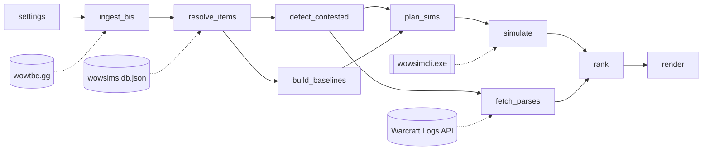
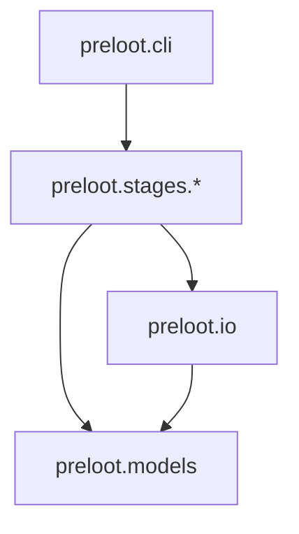
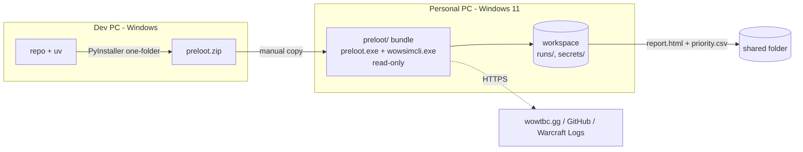

# Architecture Spine — PreLoot

## Design Paradigm

**Pipes-and-filters.** PreLoot is a one-shot batch pipeline that runs on the user's Windows 11 PC once per Target Phase. Each stage reads the settings and the artifacts written by earlier stages, then writes its own artifacts to the run folder. Stages never call each other. The only other things they share are the artifact models in `preloot/models`.



| Stage | Writes |
| --- | --- |
| settings | `settings.json` |
| ingest_bis | `bis_lists.json` |
| resolve_items | `resolved_bis.json` |
| detect_contested | `contested.json` |
| build_baselines | `baselines.json` |
| plan_sims | `sim_plan.json` |
| simulate | `sim_ledger.jsonl` |
| fetch_parses | `parses.json` |
| rank | `priority.json` |
| render | `report.html`, `priority.csv` |

## Invariants & Rules



Stages may import `models` and `io` only. `models` imports nothing from PreLoot. No stage imports another stage.

### AD-1 — Stages communicate only through persisted artifacts [ADOPTED]

- **Binds:** all stages
- **Prevents:** stages coupled in memory; a crash losing hours of sims; a report rebuild that forces sims to run again
- **Rule:** A stage is a function of `settings.json` plus its upstream artifacts. It writes only its own artifacts, in the run folder, through `preloot.io`. It never imports or calls another stage.

### AD-2 — One external source per stage [ADOPTED]

- **Binds:** ingest_bis, resolve_items, simulate, fetch_parses
- **Prevents:** two stages disagreeing on source data; the wowtbc.gg fallback turning into a change across several stages
- **Rule:** Each external source is touched by exactly one stage: wowtbc.gg by `ingest_bis`, wowsims `db.json` by `resolve_items`, `wowsimcli.exe` by `simulate`, Warcraft Logs by `fetch_parses`. Every other stage reads only artifacts.

### AD-3 — Artifact shapes are defined once in `preloot.models`

- **Binds:** all stages, render
- **Prevents:** two stages disagreeing on a field's name, type or unit
- **Rule:** Each artifact is a pydantic model in `preloot.models`, carrying `schema_version` and `run_id`. Stages read and write artifacts only through these models. A change of shape is a change to the model.

### AD-4 — Canonical identities [ADOPTED]

- **Binds:** FR-2, FR-3, FR-4, FR-8; all stages downstream of resolve_items
- **Prevents:** failed joins across sources; heroic and normal items with the same name being merged; distinct talent Specs collapsing into one merged wowsims spec
- **Rule:**
  - A Spec is identified by its PreLoot talent-spec ID (e.g. `fury_warrior`, `arms_warrior`), not by its wowsims spec name. A slot is identified by its wowsims `ItemSlot` name.
  - From `resolve_items` onward, an item is identified by its wowsims item ID (an integer). Item names are for display only.
  - Only the stage that reads a source translates that source's naming (wowtbc.gg slugs, Warcraft Logs spec names).
  - A single table in `preloot.models` maps each Spec to its class, Role, wowsims spec and talent build. Several Specs may share one wowsims spec (e.g. `fury_warrior` and `arms_warrior` both sim as `dps_warrior`), and `simulate` reads the wowsims spec and talent build only from this table.
  - A Spec's Role is fixed across all Phases. A class with two Roles has separate Specs (e.g. `shadow_priest`, `holy_priest`).
  - A Contested Item is identified by `(item_id, role)`. An item on both DPS and Healer BiS Lists yields two Contested Items, which `detect_contested` flags as cross-Role.

### AD-5 — Baselines are keyed by owner, not by Spec [ADOPTED]

- **Binds:** build_baselines, plan_sims, simulate, rank
- **Prevents:** adding roster tailoring later forcing a redesign of the sim and rank stages
- **Rule:**
  - A Baseline Set is `{owner_id, spec, items_by_slot}`. In v1, `owner_id` equals the spec name.
  - `plan_sims`, `simulate` and `rank` key every record by `owner_id` and read the Spec from the baseline.
  - Adding roster tailoring means adding a new baseline source. Nothing downstream changes.

### AD-6 — `plan_sims` alone enumerates the sims

- **Binds:** FR-5, FR-6; plan_sims, simulate, rank
- **Prevents:** the sim and rank stages disagreeing on which combinations exist; some combinations being silently skipped or run twice
- **Rule:**
  - `plan_sims` enumerates every (owner, Contested Item, slot placement, companion-slot option) per FR-6, plus one baseline entry per owner.
  - Only `plan_sims` computes `combo_key`, with one deterministic function in `preloot.models` over the entry's content. Every other stage treats `combo_key` as an opaque value.
  - `simulate` runs exactly the plan.
  - `rank` evaluates exactly the plan, pairing each combination with its baseline entry. It keeps every combination in `priority.json` and marks the best one per FR-6.

### AD-7 — `simulate` records raw paired results in an append-only ledger [ADOPTED]

- **Binds:** FR-5, FR-6; simulate
- **Prevents:** duplicated or lost sims after a crash; unpaired noise between a baseline and its candidate
- **Rule:**
  - Each plan entry runs one `wowsimcli.exe sim` (protojson `RaidSimRequest`). It uses the seed and iterations from `settings.json`, the same values for the baseline and the candidate.
  - Each result is appended as one line to `sim_ledger.jsonl`, keyed by `(owner_id, combo_key, seed, iterations, wowsims_version)`.
  - On start, keys already in the ledger are skipped. A final line that is truncated or doesn't parse is discarded and its sim runs again.
  - The ledger stores only raw metrics: DPS and HPS mean and standard deviation.

### AD-8 — Only `rank` computes derived metrics

- **Binds:** FR-5, FR-7, FR-8; rank, render
- **Prevents:** the report and the CSV computing percentages, error margins or tie order differently
- **Rule:**
  - Upgrade Value, Raw Gain, the error margin, the best combination per FR-6, the Tie-Break and the final ordering are computed only in `rank` and stored in `priority.json`.
  - `render` only formats `priority.json` and the upstream artifacts. It never recomputes or re-sorts values. The HTML and the CSV preserve the order in `priority.json`.

### AD-9 — Data problems are recorded as data [ADOPTED]

- **Binds:** FR-2, FR-3, FR-8, FR-9; all stages
- **Prevents:** one bad item stopping a multi-hour run; items silently disappearing
- **Rule:**
  - Items that can't be resolved, skipped Specs, missing Warcraft Logs parses and individual failed sims are recorded as typed `Issue` entries in the artifact of the stage that found them. Source-reading stages also record coverage counts, such as the name-to-ID match rate per Spec.
  - `render` collects the `Issue` entries and coverage counts from every stage artifact and shows them in the report.
  - Exceptions are only for environment failures: no network, a missing `wowsimcli.exe`, or an artifact that fails its model.

### AD-10 — Run folders are frozen per phase, and the settings define the run [ADOPTED]

- **Binds:** all stages; FR-1, FR-9
- **Prevents:** different stages using different settings; "which data was this?" having no answer mid-phase; a partially overwritten run
- **Rule:**
  - Only `cli` reads command-line arguments. It writes `settings.json` once at the start of a run: the Target Phase and Previous Phase, the encounter, iterations, seed, the wowsims version and the source URLs. Stages read run parameters only from `settings.json`.
  - A run lives in `runs/<target_phase>/<run_id>/`. `cli` resumes the latest run whose settings are identical; any change in settings starts a new `run_id`.
  - Artifacts are write-once. A stage writes to a temporary file and renames it only after model validation succeeds. A stage whose artifact already exists is skipped. An artifact that fails its model is an environment failure (AD-9).
  - Each source-reading stage records its fetch timestamp and source version in its artifact. The report shows these together with the sim settings.

### AD-11 — wowsims version lock

- **Binds:** resolve_items, simulate
- **Prevents:** the item IDs and slots in `db.json` disagreeing with what the bundled sim engine knows
- **Rule:** `db.json` comes from the same wowsims tag as the bundled `wowsimcli.exe` (v0.0.145 at authoring). That tag is recorded in `settings.json`.

### AD-12 — The install bundle is read-only; state lives in the workspace [ADOPTED]

- **Binds:** packaging, all stages
- **Prevents:** resume data being lost to temp folders; an upgrade overwriting a run; credentials ending up in the bundle
- **Rule:**
  - The PyInstaller folder is never written to.
  - All mutable state lives under the workspace root given by `--workspace`: runs, the ledger, settings and secrets.
  - Warcraft Logs credentials come from `<workspace>/secrets/` or environment variables, and are never written to any artifact.

### AD-13 — The publish boundary is one self-contained HTML file plus the CSV [ADOPTED]

- **Binds:** FR-7, FR-9; render
- **Prevents:** a shared report that breaks off the PC, leaks secrets or raw sim data, or lets text from a source inject code into the page
- **Rule:**
  - Only `report.html` (tabs: Priority Table, Contested Items, BiS Lists) and `priority.csv` go to the shared folder.
  - All CSS and JS are built into the HTML file, with no external scripts or fonts.
  - Outbound links go only to Wowhead item pages and to the data-source credits.
  - Jinja2 runs with automatic escaping turned on.

### AD-14 — One canonical Phase identity

- **Binds:** FR-1, FR-3, FR-8; cli, ingest_bis, resolve_items, fetch_parses
- **Prevents:** stages disagreeing on which Phase is "previous", or comparing wowtbc.gg flags against wowsims phase numbers
- **Rule:**
  - The canonical Phase ID is the TBC Anniversary phase (`pre`, `p1`–`p5`).
  - The mapping between canonical IDs, wowtbc.gg flags and wowsims phase numbers is a single table in `preloot.models`.
  - Only `cli` derives the Previous Phase, and writes both Phases to `settings.json`.
  - `ingest_bis` and `resolve_items` translate at their source boundary. `resolve_items` accepts only items whose wowsims phase is at or before the Target Phase.
  - `fetch_parses` fetches parses for the Previous Phase.

## Consistency Conventions

| Concern | Convention |
| --- | --- |
| Naming | Stage modules `preloot/stages/<stage>.py`, one per stage in the table above. Artifact file names exactly as listed. Python `snake_case`. |
| Data & formats | UTF-8 JSON, JSONL for the ledger. Integer IDs. Timestamps in ISO-8601 UTC. Percentages stored as fractions (0.034) and formatted only in `render`. |
| Errors | `Issue{stage, kind, subject, detail}` in the artifact (AD-9). Exceptions only for environment failures. |
| Config | `settings.json` in the run folder is the single source for run parameters (AD-10). No stage reads its own configuration. |
| HTTP | Standard-library `urllib` with `truststore` (the OS certificate store) in every stage that fetches. A descriptive User-Agent. A download is cached into the run folder and never fetched twice. |
| Logging | Plain text in `<run>/run.log`. Progress lines per stage. Never logs credentials. |
| Parallelism | `simulate` runs `wowsimcli.exe` processes in parallel, one per CPU core by default. The ledger has a single writer. |

## Stack

| Name | Version |
| --- | --- |
| Windows (run target) | 11 x64 |
| Python | 3.14.2 |
| uv (dev only) | 0.12.20 |
| pydantic | 2.13.5 |
| Jinja2 | 3.1.6 |
| truststore | 0.10.4 |
| PyInstaller (one-folder) | 6.22.3 |
| wowsims tbc-new `wowsimcli` + `db.json` | v0.0.145 |

## Structural Seed



```text
preloot/                 # repo root
  src/preloot/
    cli.py               # `preloot run --workspace <dir> --phase <p>`
    models/              # pydantic artifact models, spec/role table (AD-3, AD-4)
    io/                  # artifact read/write, HTTP + truststore, run folder paths
    stages/              # one module per stage (AD-1)
    templates/           # Jinja2 report template, CSS/JS built in (AD-13)
  vendor/wowsims/        # wowsimcli.exe v0.0.145, bundled by PyInstaller (AD-11)
  preloot.spec           # PyInstaller one-folder build

<workspace>/             # on the personal PC, outside the bundle (AD-12)
  secrets/               # Warcraft Logs credentials
  runs/<target_phase>/<run_id>/   # settings.json, stage artifacts, sim_ledger.jsonl, run.log, report.html
```

## Capability → Architecture Map

| Capability | Lives in | Governed by |
| --- | --- | --- |
| FR-1 Select target phase | cli, settings | AD-10, AD-14 |
| FR-2 Load BiS lists for non-Tank Specs | ingest_bis | AD-2, AD-4, AD-9 |
| FR-3 Resolve items to item IDs | resolve_items | AD-2, AD-4, AD-9, AD-11, AD-14 |
| FR-4 Detect contested items | detect_contested | AD-4 |
| FR-5 Compute Upgrade Value | plan_sims, simulate, rank | AD-6, AD-7, AD-8 |
| FR-6 Paired-slot combinations | plan_sims | AD-6 |
| FR-7 Priority table + CSV | rank, render | AD-8, AD-13 |
| FR-8 Tie-Break | fetch_parses, rank | AD-2, AD-8, AD-9, AD-14 |
| FR-9 Functional HTML report | render | AD-10, AD-13 |

## Deferred

- **Testing strategy:** unit tests per stage against fixture artifacts are the natural fit, but the choice belongs to the first build.
- **Warcraft Logs details:** which percentile, which API endpoint, how authentication works (PRD §8 OQ2). They are contained inside `fetch_parses` by AD-2.
- **Healer HPS feasibility:** a test run on one Healer Spec (PRD §8 OQ3). The sim path is identical to DPS by AD-7. If it fails, healer ranking is dropped without any change to the pipeline.
- **How `db.json` is obtained:** fetched from the tag or bundled. Either is fine under AD-11.
- **Command-line experience:** progress display, flags beyond `--workspace` and `--phase`.
- **Roster tailoring:** whether a raider ever competes against a generic Spec baseline. Waits for the roster change. AD-5 keeps the pipeline ready for it.
- **wowtbc.gg fallback source:** a hand-curated BiS List if permission is refused. It would replace `ingest_bis` only (AD-2).
- **Error-margin formula:** how the sim error margin that defines a tie is computed. Owned by `rank` alone (AD-8), and recorded in `priority.json`.
- **Source of talent builds:** where each Spec's talent build and rotation options (e.g. Hunter BM/MM/SV) come from: wowsims presets or a table maintained by hand. The values live in the AD-4 table either way.
- **Backup and retention of run folders:** the user's responsibility on the personal PC. Only the published report goes to the shared folder.
