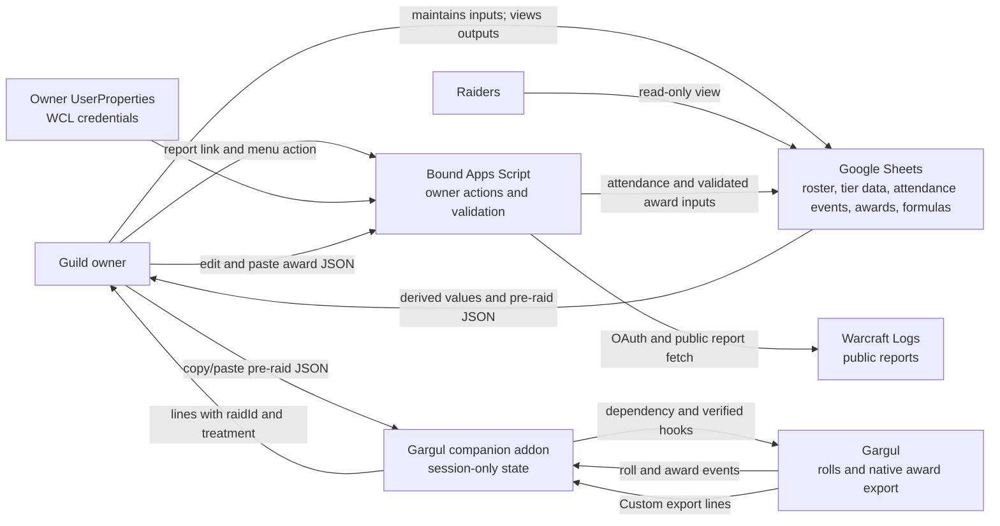

# Architecture Spine — Guild Loot Distribution

## Design Paradigm

The Google Sheets workbook is the durable system of record. Its bound Apps Script coordinates external attendance fetches and validated imports; native Sheet formulas derive published priority values. A Gargul-dependent companion addon is a session-scoped adapter that displays those values and records raid awards without becoming a second durable store.

## Invariants & Rules

### AD-1 — Sheets owns durable state

- **Binds:** CAP-1, CAP-2, CAP-3, CAP-4, CAP-5, CAP-7, CAP-8
- **Prevents:** Sheets and the addon becoming competing authorities for roster, attendance, loot history, or tier state.
- **Rule:** Persist one roster across WoW eras, one active tier at a time, active-tier inputs, attendance, award history, and archives in the workbook. The owner maintains configuration inputs; the bound Apps Script applies attendance and award imports. The workbook records the single open raid in Config (Raid ouvert) until its ledger is committed; refuse tier activation while a raid is open. Archives are read-only and non-restorable, and their raids still count toward Lifetime Presence; archive and activate a new tier together in one atomic workbook batch. MVP uses no separate hosted service or desktop GUI. The companion holds only the current raid's working snapshot and award events.

### AD-2 — Sheet formulas own derived priority values

- **Binds:** CAP-2, CAP-3, CAP-4, CAP-6, CAP-7
- **Prevents:** Independent implementations producing different Presence, BiS Ratio, or Impact Score values.
- **Rule:** Native Sheet formulas compute canonical derived values from workbook inputs and expose their breakdown to raiders. The allocation-rules companion is the calculation contract.
  - **Presence:** Tier Presence counts raids dated on or after Config's BiS reset date. Lifetime Presence counts every raid, archived tiers included. Both use the Présence grid, where `1` and `B` count.
  - **BiS Ratio** uses Tier Presence.
  - **Impact Score** = Normalized Lifetime Presence × parse × item gain / (Impact Items + 1). The item gain is the dropped item's Gain (%) for the roller's spec on the role's Objets tab, stored as a fraction. It applies only when that item's Statut for the roller's spec is `IMPACT`.
  - **Roster columns:** the raider part, Impact (sans gain objet). Gargul computes the full score per dropped item.
  - Tanks have no Impact Score, and there is no tank priority. Statut values are `BIS`, `IMPACT`, `CLASS_BOUND`, `NORMAL`.
  - **BiS reset:** it is the activation of a new tier (no reset inside a tier, owner decision 2026-10-22), triggered in Sheets between raids, after importing the previous raid's ledger and before preparing the next. It restarts Tier Presence and the BiS-loot count; Lifetime Presence continues. Late attendance for a pre-reset raid is corrected manually.
  - BiS cannot be passed; where nobody marks an item BiS, interested Raiders roll without BiS Ratio impact. An `IMPACT`-treated BiS award leaves BiS Ratio unchanged and updates Impact state.
  - **Precision:** compare unrounded results and round only for three-decimal display. Verify parity with shared near-tie, exact-tie, and item-gain fixtures.

### AD-3 — Character names are canonical identifiers

- **Binds:** CAP-1, CAP-2, CAP-6, CAP-7
- **Prevents:** Attendance and award records resolving to different Raiders because components silently normalize names differently.
- **Rule:** Require unique, exact owner-maintained character-name strings as Raider keys in Sheets and both JSON handoffs; reject duplicate keys. Preserve casing and special characters. Award recipients come from Gargul's `@WINNER` export token, which Gargul already returns without the realm (assumed correct on WoW Forever); match it exactly against one roster key. Award recipients are never resolved through the Rerolls mapping (an award to an alt is rejected for owner correction). Reject unmatched or ambiguous awards; ignore unmatched Warcraft Logs participants for owner correction.

### AD-4 — Award authority remains with the owner

- **Binds:** CAP-3, CAP-4, CAP-6
- **Prevents:** The addon turning item classification or displayed priority into an implicit automated award.
- **Rule:** The owner decides every award, even against the displayed ratio, score, or roll, and awards manually through Gargul. The companion reads the owner's Statut and Gain from the snapshot to show the applicable values; it never classifies items, chooses which signal applies, or chooses or assigns recipients.

### AD-5 — The Gargul integration is a companion addon

- **Binds:** CAP-6, CAP-7
- **Prevents:** Unnecessary coupling to a Gargul fork, a second parallel codebase, or carrying over legacy rules that contradict this spine.
- **Rule:** Build the companion and the bound Apps Script by modifying the owner's existing repo `zambelaba/Gargul_Preloot`: its Lua addon (Gargul dependency; hooks on `MasterLooterUI:tableColumns`, `RollOff:refreshRollsTable`, `AwardedLoot:addWinner`, the Gargul importer, and `Exporter:transformEntriesToCustomFormat`) becomes the companion, and `tools/google_apps_script` seeds the bound script. Both replace the existing single attendance/loot ratio with the BiS Ratio and Impact Score of AD-2. Where existing code contradicts an AD, the AD wins: remove `GargulPrelootDB` persistence, the random ratio shown for unknown players, case-insensitive and realm-specific name normalization, the old attendance/loot ratio, loot coefficients, hard-coded date cutoffs, RCLootCouncil import, and Script Properties credentials. Add companion columns after Gargul's native roll-table columns, never inserted among them: Gargul reads roll type, sort keys, and the gear toggle by fixed column index. Only the owner uses the companion; raiders keep Gargul's default interface and install nothing. Assume Gargul v8.0.1 fully supports WoW Forever; obtain owner approval before modifying or forking Gargul itself.

### AD-6 — JSON handoffs preserve award meaning

- **Binds:** CAP-6, CAP-7
- **Prevents:** A transfer format losing award context, invalid input changing state, or a non-editable export blocking owner corrections.
- **Rule:** The pre-raid snapshot follows the Interchange v1 contract below and may be pasted raw or Base64-encoded (the existing importer's format); reject mismatched tier, unknown raid, or unsupported version. Create the raid ID once when preparing a new raid, reuse it on repeated exports of that raid's snapshot, and close it only with the atomic ledger commit. The snapshot carries the Objets item table exactly as the owner entered it; the addon never derives or changes a Statut. Before replacing session state, recompute each supplied BiS Ratio and non-tank Impact base from the operands, reject missing or materially mismatched display values, and thereafter display only recomputed unrounded values (rounding at presentation). Use a validation tolerance of `1e-9 * max(1, abs(recomputed))` solely for cross-runtime import checks, never for ranking or tie comparisons. Successful import starts the session: the companion records, by Gargul award checksum, each subsequent award's owner-selected treatment (`BIS`, `IMPACT`, `CLASS_BOUND`, `NONE`), never by array position or item ID; edits update the checksum entry and deletions remove it. Recompute all live counters and scores from the imported snapshot and the session's awards after any award change, before the next roll. `IMPACT` updates only Impact state, including for a BiS item, and `NONE` and `CLASS_BOUND` update neither counter (`CLASS_BOUND` only tints the Awards row: rare blue, `NONE` uncommon green). The post-raid ledger is Gargul's own Custom export rendered with the Gargul export template below; the companion fills its `@GPRAID` and `@GPTREATMENT` tokens per line from the session, leaving them empty for awards it did not capture. It post-processes Gargul's returned export text line by line: it reads each line's checksum (`"checksum":"..."`), looks it up in the session map, and replaces the two tokens as plain text, never mapping lines to awards by position. Gargul's export settings exclude off-spec and disenchanted items, so those never reach Sheets. Sheets still forces `NONE` for any `os` record; the owner marks pattern/design awards `NONE`. Before writing, Sheets ignores lines whose `raidId` belongs to an already-committed raid, then validates the rest as a whole; it rejects the ledger if any line is malformed, has a `raidId` other than the single open raid (including empty or literal `@GPRAID`), an empty `treatment`, a duplicate checksum, or an unmatched recipient, listing each rejected line's checksum, date, time, and winner. The owner may edit the JSON text before import. A later re-upload of the same ledger is owner-managed without deduplication.

### AD-7 — Warcraft Logs access is owner-triggered and owner-scoped

- **Binds:** CAP-2
- **Prevents:** Shared-workbook viewers or committed code receiving API credentials, and attendance fetching occurring without an owner action.
- **Rule:** The owner manually maintains parse inputs, pastes a public report link into Sheets for a scheduled raid instance, and invokes the bound Apps Script menu action. Use Warcraft Logs API v2 public-report client credentials stored in `PropertiesService.getUserProperties()`; never place secrets in workbook cells, JSON, shared `ScriptProperties`, or committed source. Each workbook `raidId` represents one scheduled raid instance and one possible-raid increment in both window maxima; attendance and bench credit each contribute at most once per Raider and `raidId`. List each imported report code in the raid's Raids row (Rapports WCL), merge overlapping reports into the same attendance event without another denominator increment, and treat a code already listed as a no-op. Evaluate attendance once per `raidId` and resolved roster key: count the distinct completed boss-encounter fights (kills and wipes) across all merged reports, and credit the Raider when the main or any Rerolls alt took part in strictly more than 25% of them (all completed fights when there is no boss encounter). An exact alt name listed in the workbook's Rerolls mapping credits its main's roster key for attendance only; reroll names must not duplicate roster keys. Serialize report checks, tier/BiS resets, and ledger commits; defer score-affecting input edits and attendance during an open raid. Commit the report code and the matched attendance (`1` in the raid's Présence row; the owner types `B` for bench) in one atomic workbook batch. If WCL data changes later, the owner corrects attendance manually; ignore unmatched participants.

### AD-8 — Gargul state is session-only

- **Binds:** CAP-6, CAP-7
- **Prevents:** An old raid snapshot or SavedVariables copy surviving as an alternate source of truth.
- **Rule:** Do not persist the companion's roster snapshot, award treatments, or raid selection in its SavedVariables. Import current workbook state before every raid; reload/crash recovery during a raid is out of scope. After a `/reload`, exported lines have empty `raidId`/`treatment`; the owner fills them in the JSON text, or deletes a line that belongs to another raid, before import. Gargul's own native award history is not the companion's durable state and must not be imported as a full-history snapshot.

## Consistency Conventions

| Concern | Convention |
| --- | --- |
| Naming | Unique exact roster keys; award recipients are Gargul's realm-less `@WINNER` value matched exactly. No case-folding. |
| Data & formats | Pre-raid: versioned, tier- and raid-bound JSON with each Raider's spec, numeric Presences, counts, parse, BiS Ratio and Impact base, plus the Objets item table (Statut and Gain per item and spec) as the owner entered it. Post-raid: Gargul Custom export, one JSON object per award line, with companion-filled `raidId` and `treatment`. |
| State & cross-cutting | Serialize owner actions and validate whole imports before committing; use one atomic Sheets API batch for multi-range mutations. WCL report IDs are no-ops on re-import; award-ledger re-uploads remain owner-managed. Keep WCL secrets in owner `UserProperties`. |

### Interchange v1

All fields below are required unless marked nullable. Reject missing fields, invalid types, non-finite numbers, non-integer raid/loot counts, negative scores or Gain, Presence greater than its maximum, and invalid role/priority combinations before replacing the addon snapshot or writing to Sheets. Export numeric formula operands without display rounding.

| Payload | Fields and meaning |
| --- | --- |
| Pre-raid envelope | `schemaVersion` integer `2`; `tierId`, `raidId` nonempty strings from Config. The BiS window is the tier, so there is no separate window ID (2026-10-22). |
| Pre-raid | `raiders` array with unique entries by `raiderKey` (exact character-name string). Each entry has `role` (`DPS`, `HEALER`, `TANK`, mapped from the five Rôle values), `classSpec` (spec label as in the Objets tabs, e.g. `Mage Givre`), `tierPresence`, `tierPresenceMax`, `lifetimePresence`, `lifetimePresenceMax`, `bisLootCount`, `impactLootCount` (nonnegative integer counts; maxima integers at least `1`), `dpsParse` (percentage-point value from `1` to `100`; missing input exported as `1`), `bisRatio` (unrounded number), and `impactBase` (unrounded Lifetime × parse / (Impact Items + 1), or `null` for tanks). |
| Pre-raid items | `items` array with unique entries by `itemID` (integer). Each entry has `specs`: an array of `{classSpec, statut, gainFraction}` for each spec with an entry, where `statut` is `BIS`, `IMPACT`, `CLASS_BOUND`, or `NORMAL` and `gainFraction` is a finite number (may be negative) or `null`. The full Impact Score for a roller is `impactBase × gainFraction` of the dropped item for the roller's `classSpec`, only when that `statut` is `IMPACT`. |
| Post-raid | Gargul Custom export text: one JSON object per line, each ending with `,`; Sheets wraps the text in `[` `]` after removing the final comma. No envelope: the tier comes from the workbook's record for `raidId`. Fields: `checksum` (nonempty, unique), `winner` (exact roster key), `itemID` (integer), `itemName` (string, may be empty), `rollType` (string; `-` means no roll bracket), `os` (`0`/`1`), `date`, `time`, `raidId`, `treatment` (`BIS`, `IMPACT`, `CLASS_BOUND`, `NONE`). An empty export is valid for a raid with no awards. |

**Gargul export template** — set Gargul's export format to *Custom* (`ExportingLoot.format` = `4`), untick *Include offspec items* and *Include disenchanted items*, and paste this one line as the custom format (`ExportingLoot.customFormat`):

```text
{"checksum":"@CHECKSUM","winner":"@WINNER","itemID":@ID,"itemName":"@ITEM","rollType":"@ROLLTYPE","os":@OS,"date":"@DATE","time":"@TIME","raidId":"@GPRAID","treatment":"@GPTREATMENT"},
```

Gargul replaces its own `@` tokens; the companion replaces `@GPRAID` and `@GPTREATMENT`. Gargul omits an award whose item data is not yet cached and exports only the dates selected in its exporter, so the owner checks that the award count matches before importing. Item names (`@ITEM`, added 2026-10-22 at the owner's request) are for display only: `itemID` identifies the item, and the Objets tab name wins when one exists; the export name fills Awards and the preview otherwise. WoW item names never contain double quotes, so the token keeps the line valid JSON.

## Workbook Layout

Setup ("Set up / refresh workbook") creates and refreshes these tabs in this order; a header conflict or owner data in a tab to be removed aborts setup with no write.

| Tab | Holds | Written by |
| --- | --- | --- |
| Roster | Raider, Classe, Spé, Rôle, Parse WCL moyen; formula columns from story 4.3 | Owner (formulas by setup) |
| Rerolls | Reroll, Classe, Spé, Rôle, Parse WCL moyen, Personnage principal | Owner |
| Présence | One row per raid, one column per raider: `1` present, `B` bench, `0` absent; Total row | Script (`1`), owner (`B`) |
| Raids | Raid (ID), Instance, Date du raid, Rapports WCL, Importé le | Script |
| Awards | One 5-column block per raider: Date, Objet, Objet (ID), Traitement, Raid (ID) | Script (ledger import) |
| Objets Tank / Heal / Melee DPS / Ranged DPS / Caster DPS | One row per item; Statut and Gain (%) per spec of the role | Owner |
| Config | Palier actif, Début fenêtre BiS (tier start date), Raid ouvert | Script and owner |
| `_Listes` (hidden) | Class → spec dropdown helper | Setup |

## Stack

| Name | Version |
| --- | --- |
| Google Apps Script runtime | V8 |
| Google Sheets API | v4 (`spreadsheets.batchUpdate` through Advanced Sheets service) |
| Warcraft Logs public GraphQL API | v2 |
| WoW Forever client (first target) | 1.60.1; interface `16001` |
| Gargul Forever | `v8.0.1-forever` (assumed full WoW Forever support) |
| Gargul_Preloot (brownfield base for companion and Apps Script) | `1.1.0` (`main`) |

## Structural Seed



**Runtime & operations:** The bound Apps Script runs from the Google Sheets workbook under the owner account. Attendance fetching and workbook mutations are initiated by the owner; no background trigger or separate server is required. The Gargul companion is installed only in the owner's WoW Forever client. The owner transfers JSON manually before and after each raid. Raiders use read-only Sheets views and do not install the companion.

**Source layout (brownfield, `zambelaba/Gargul_Preloot`):** `Core.lua` + `Gargul_Preloot.toc` — companion addon (TOC interface must move from `20506` to Forever `16001`); `tools/google_apps_script/` — source for the bound Apps Script.

**First tier seed:** WoW Forever: The Barrow Deeps (10-player), Hyjal Summit (20-player), and Onyxia's Lair (40-player). Each raid has its own pre-raid snapshot and one-raid award export; the tier and roster persist across those raid batches.

## Capability → Architecture Map

| Capability / Area | Lives in | Governed by |
| --- | --- | --- |
| CAP-1 — Roster and phase data | Google Sheets | AD-1, AD-3 |
| CAP-2 — Attendance | Bound Apps Script, workbook inputs/formulas | AD-1, AD-2, AD-7 |
| CAP-3 — BiS priority | Sheet formulas; companion display | AD-2, AD-3, AD-4 |
| CAP-4 — Impact priority | Sheet formulas; companion display | AD-2, AD-4 |
| CAP-5 — Raider-facing views | Read-only Roster (class, spec, role, parse, Tier and Lifetime Presence, BiS Ratio, Impact (sans gain objet)), Rerolls, Présence grid, Raids, Awards blocks, and one Objets tab per role (Statut and Gain per spec) in Sheets | AD-1, AD-2 |
| CAP-6 — Manual Gargul awards | Gargul and companion addon | AD-4, AD-5, AD-8 |
| CAP-7 — Pre/post-raid synchronization | Sheets, bound Apps Script, companion addon | AD-1, AD-3, AD-5, AD-6, AD-8 |
| CAP-8 — Tier transitions and archives | Google Sheets and bound Apps Script | AD-1, AD-2 |

## Deferred

- The owner enters WoW Forever class/spec, item, BiS, and simulation data for the three first-tier raids in Sheets once it is available; the build does not wait for it. The roster spans WoW eras, but no complete future item catalog is required.
- Gargul export template: confirm in game that wrapping `Exporter:transformEntriesToCustomFormat` fills `@GPRAID`/`@GPTREATMENT` on every line, and record one real export as a test fixture for the Apps Script parser.
- Check that WoWSims Forever or another owner-chosen sim can supply per-item, per-spec percent Gain inputs for the Objets tabs of the first tier.
- Choose whether to use CLASP for local development/deployment; it is optional tooling, not a runtime dependency.
- Determine the owner's setup procedure for initial WCL credential entry and Apps Script authorization during implementation.
- At implementation, enable and authorize the Advanced Sheets service, test failure atomicity, and verify serialized owner actions cover checks and writes without races.
- A local desktop GUI with local JSON persistence and no hosting cost remains a future preference, not an MVP requirement.